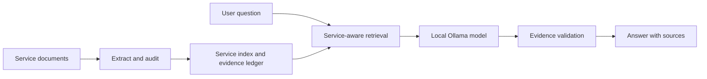

# BURHAN

**Evidence-first question answering for government-service documents.**

BURHAN is a local, terminal-based assistant that answers questions using a supplied collection of documents. It combines document extraction, service-aware retrieval, an evidence ledger, and an Ollama language model to produce answers with traceable sources.

## Features

- **Document ingestion:** PDF, DOCX, TXT, and Markdown, with optional OCR for scanned PDFs.
- **Structured extraction:** PyMuPDF for page references and Microsoft MarkItDown for cross-checking.
- **Relevant retrieval:** Arabic-aware normalization, keyword ranking, and service-level context.
- **Evidence checks:** Source citations, numeric-claim validation, and potential conflict reports.
- **Local inference:** Uses the configured Ollama model without a hosted AI API.
- **Optional voice:** Microphone transcription and spoken responses through a separate CLI command.

## Architecture



## Quick start

Install Python and [Ollama](https://ollama.com/download), then open PowerShell in the project root.

```powershell
# Install project dependencies and run tests.
powershell -ExecutionPolicy Bypass -File .\scripts\setup_windows.ps1

# Download a practice model. Use the organizers' exact model when required.
ollama pull qwen3:8b

# Run the included practice demo.
powershell -ExecutionPolicy Bypass -File .\scripts\run_demo.ps1 -Model qwen3:8b
```

To use your own documents, place supported files in **`docs/`**, then run:

```powershell
# Replace the example model tag with your installed model.
powershell -ExecutionPolicy Bypass -File .\scripts\competition_start.ps1 -Model 'MODEL_TAG'
```

This command builds `build/index.json`, writes an evidence audit to `build/evidence_audit.json`, and launches the text chatbot. Review extraction warnings before trusting an answer.

## Project layout

| Path | Purpose |
| --- | --- |
| `docs/` | Input service documents. Keep practice documents separate. |
| `burhan/` | Extraction, retrieval, evidence checks, Ollama integration, and voice code. |
| `scripts/` | Setup, model preparation, ingestion, demonstration, and backup utilities. |
| `build/` | Generated index, audit reports, and evaluation results. |
| `practice/` and `examples/` | Synthetic documents and sample evaluation questions. |
| `tests/` | Automated tests. |

## Additional commands

<details>
<summary>Show CLI command reference</summary>

| Task | Command |
| --- | --- |
| Inspect extracted pages | `.\.venv\Scripts\python.exe -m burhan inspect` |
| Review evidence and conflicts | `.\.venv\Scripts\python.exe -m burhan audit` |
| Search without model inference | `.\.venv\Scripts\python.exe -m burhan search "your question"` |
| Start text chat | `.\.venv\Scripts\python.exe -m burhan --model MODEL_TAG chat` |
| Ask by microphone | `.\.venv\Scripts\python.exe -m burhan --model MODEL_TAG voice --seconds 6` |

</details>

Microphone support requires optional voice dependencies. It is a separate recording command, not a graphical button. Details are in [SETUP_AND_WORKFLOW.md](SETUP_AND_WORKFLOW.md).

## Notes

Ingestion **indexes** the supplied files; it does not retrain or fine-tune the model. Candidate contradictions are flagged for review, not automatically confirmed. Answer reliability depends on the quality of the original documents, extraction, retrieval, and model output.

For complete installation steps, file placement, merged-document mapping, voice setup, and troubleshooting, see **[Setup and Workflow](SETUP_AND_WORKFLOW.md)**.
