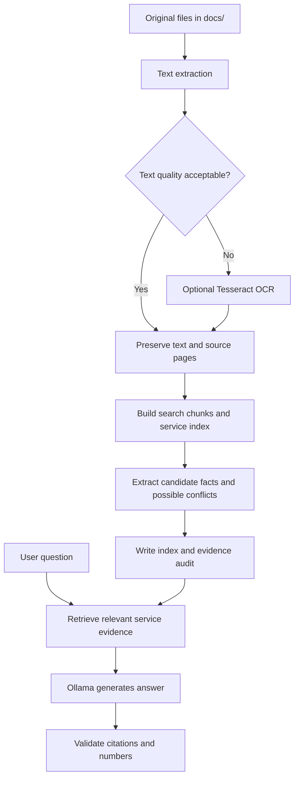

# BURHAN Setup and Workflow

This guide covers local installation, practice testing, loading new service documents, model configuration, and optional microphone use. All commands are run in **PowerShell** from the folder containing `burhan/`, `scripts/`, and `docs/`.

## 1. Install the required software

1. Install Python 3.11 or 3.12 (64-bit) from [python.org](https://www.python.org/downloads/). Ensure the Python launcher (`py`) is available.
2. Install [Ollama for Windows](https://ollama.com/download/windows). The terminal alternative is `winget install -e --id Ollama.Ollama`.
3. Extract the project ZIP into a convenient local folder, for example `C:\Projects\BURHAN\`. Open PowerShell in the extracted `BURHAN_Windows_Competition_Ready` project folder.
4. Close and reopen PowerShell if an installer changed `PATH`.

Verify the tools:

```powershell
py -3.11 --version
ollama --version
nvidia-smi
```

If you installed Python 3.12 instead, use `py -3.12 --version`. The setup script prefers 3.11 and otherwise tries the default Python 3 interpreter.

Install and test BURHAN:

```powershell
powershell -ExecutionPolicy Bypass -File .\scripts\setup_windows.ps1
.\.venv\Scripts\python.exe -m burhan doctor
```

Ollama should run locally at `http://localhost:11434`. Launch the Ollama desktop app if the server is not available. Native Ollama inference does not require a separate CUDA Toolkit installation.

## 2. Prepare the Ollama model

Download a practice model:

```powershell
ollama pull qwen3:8b
ollama list
ollama run qwen3:8b
```

Exit the interactive Ollama prompt using `/bye`. This tag is for local testing only. Set the exact required model tag when that information is confirmed:

```powershell
$env:BURHAN_MODEL = 'MODEL_TAG'
ollama list
```

A required model must appear in `ollama list`. If not, download it with `ollama pull MODEL_TAG` when downloads are allowed. You can use `ollama ps` and `nvidia-smi` to check memory allocation and GPU activity while answering.

## 3. Verify the program before loading real documents

```powershell
powershell -ExecutionPolicy Bypass -File .\scripts\run_demo.ps1 -Model qwen3:8b
```

This creates a **separate** sample index at `build/demo.json` using fictional files from `examples/`. It starts an interactive practice chat. Enter questions and type `/quit` to exit. Practice documents are never intended to be indexed as official source material.

The automated test suite can also be rerun directly:

```powershell
.\.venv\Scripts\python.exe -m unittest discover -s tests -v
```

## 4. Place the supplied documents in exactly the right folder

Use the `docs/` directory inside the project root. Copy each original service document there, preferably with one document per service. Nested subfolders are accepted. Supported extensions are `.pdf`, `.docx`, `.txt`, and `.md`.

```text
BURHAN_Windows_Competition_Ready/
|-- docs/
|   |-- service_01.pdf
|   |-- service_02.docx
|   `-- service_03.pdf
|-- scripts/
|-- burhan/
|-- build/                  (generated automatically)
`-- README.md
```

Do not place the official files in `examples/`, `practice/`, or `build/`. Do not mix practice service files into `docs/`.

For individually named service documents, run:

```powershell
powershell -ExecutionPolicy Bypass -File .\scripts\competition_start.ps1 -Model 'MODEL_TAG'
```

The script checks the environment, reads `docs/`, creates the local index and evidence audit, displays extracted page summaries, and launches text chat.

**If several services appear in one PDF**, create a `service_map.json` in the project root with the service names and 1-based PDF page numbers. For example:

```json
{
  "services": [
    {"title": "Service One", "file": "all_services.pdf", "pages": [1, 2]},
    {"title": "Service Two", "file": "all_services.pdf", "pages": [3, 4]}
  ]
}
```

Save that PDF as `docs/all_services.pdf`, then use the manual preparation path:

```powershell
.\.venv\Scripts\python.exe -m burhan prepare docs --manifest service_map.json
.\.venv\Scripts\python.exe -m burhan inspect
.\.venv\Scripts\python.exe -m burhan --model MODEL_TAG chat
```

The standard `competition_start.ps1` script does **not** accept the manifest argument, so use the manual commands for merged documents.

## 5. What document preparation actually does



`prepare` reads the documents using PyMuPDF for PDF source pages and the DOCX/text readers for other formats. MarkItDown cross-checks converted content where supported. The system creates:

- **`build/index.json`**: document names, page text, retrieval chunks, and candidate facts.
- **`build/evidence_audit.json`**: extraction warnings, fact candidates, and possible contradictions.

It does **not train the language model or modify its weights**. When you ask a question, the retriever selects relevant text from the index and passes it to the local Ollama model along with answer-grounding instructions. The answer is then checked for valid cited pages and unsupported numeric values.

Always examine extraction warnings and compare important fees, deadlines, and eligibility conditions with the original documents. Conflict reports indicate possible differences, not proven contradictions.

## 6. Search, chat, and evaluation

```powershell
# Inspect the indexed services and extracted page text.
.\.venv\Scripts\python.exe -m burhan inspect

# Review the candidate fact and conflict report.
.\.venv\Scripts\python.exe -m burhan audit

# Debug retrieval without running the model.
.\.venv\Scripts\python.exe -m burhan search 'your question'

# Ask a single question.
.\.venv\Scripts\python.exe -m burhan --model MODEL_TAG ask 'your question'

# Start interactive text chat.
.\.venv\Scripts\python.exe -m burhan --model MODEL_TAG chat
```

If you prepare a human-checked `gold.jsonl` evaluation set in the project root, you can test evidence retrieval and model answers:

```powershell
.\.venv\Scripts\python.exe -m burhan eval gold.jsonl
.\.venv\Scripts\python.exe -m burhan --model MODEL_TAG eval gold.jsonl --with-model --limit 10
.\.venv\Scripts\python.exe -m burhan --model MODEL_TAG benchmark gold.jsonl --limit 10
```

## 7. Optional microphone and spoken answers

The microphone functionality is implemented in **`burhan/voice.py`** and exposed through the **`voice`** subcommand in **`burhan/cli.py`**. There is no microphone button or separate graphical interface. `chat` is typed input; `voice` records an audio question.

Install the optional voice dependencies:

```powershell
powershell -ExecutionPolicy Bypass -File .\scripts\setup_windows.ps1 -WithVoice
```

Test a microphone recording and transcription:

```powershell
.\.venv\Scripts\python.exe -m burhan --model MODEL_TAG voice --seconds 6
```

The program records for six seconds, transcribes speech locally with faster-whisper, displays the transcript, then lets you press Enter to accept it or type a correction before asking Ollama. By default, Whisper runs on the CPU to leave GPU memory for Ollama. The first run may download the `small` speech model; test and cache it while internet access is available.

For spoken answers, add `--speak`:

```powershell
.\.venv\Scripts\python.exe -m burhan --model MODEL_TAG voice --seconds 6 --speak
```

Speech output uses an Arabic voice installed in Windows System.Speech. If no compatible voice exists, the answer is printed instead. Check microphone permissions, the selected Windows input device, and transcription accuracy before relying on voice mode. Voice is optional and not required for document answering.

## 8. Optional OCR, offline preparation, and backup

For image-only/scanned PDFs, install Tesseract with Arabic language data. Verify that `tesseract --list-langs` includes `ara`. If Tesseract is not on PATH, set `BURHAN_TESSERACT` to the executable path. Normal text-based PDFs do not require OCR.

```powershell
# Download dependency wheels for later offline reinstall.
powershell -ExecutionPolicy Bypass -File .\scripts\prepare_offline.ps1

# Create a backup archive of the project and output files.
powershell -ExecutionPolicy Bypass -File .\scripts\create_backup.ps1
```

Dependency wheels do not include Ollama, model weights, system OCR tools, or audio model caches. Install and test those components separately if offline use is required.

## Troubleshooting

| Symptom | Check |
| --- | --- |
| `ollama` command not found | Install Ollama, then reopen PowerShell. |
| Ollama connection refused | Launch Ollama and confirm `http://localhost:11434` is reachable. |
| `MODEL_TAG` not installed | Run `ollama list`, then download or select an installed tag. |
| Text missing or unreadable | Inspect extraction warnings and enable Arabic OCR for scanned pages. |
| Wrong service retrieved | Check document mapping, filenames, and `burhan search` results. |
| Voice fails | Install voice dependencies, select a working microphone, and pre-cache the speech model. |

Every asserted government-service fact should be supported by a supplied source. When documentation is missing or ambiguous, the appropriate behavior is to report uncertainty instead of guessing.
